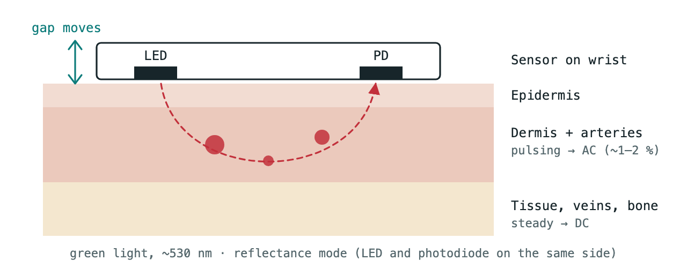
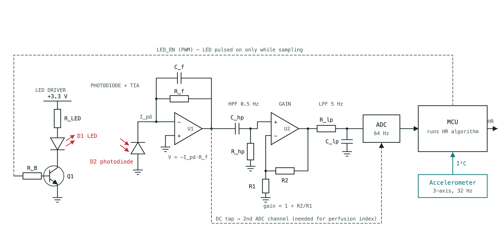
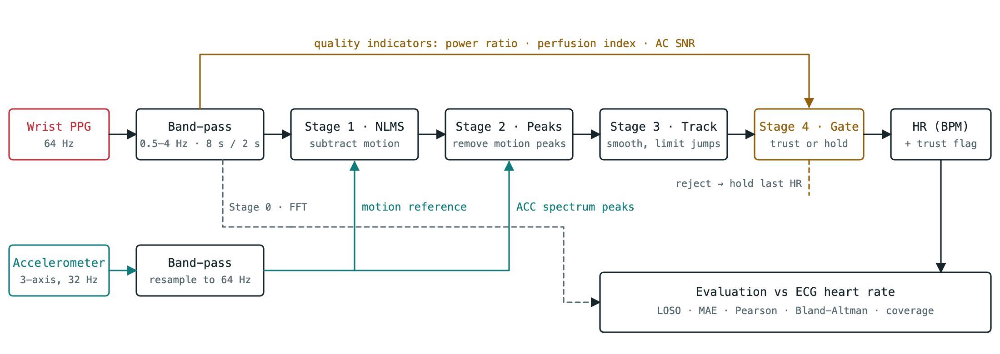
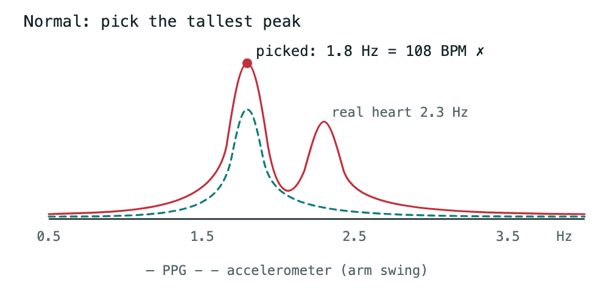
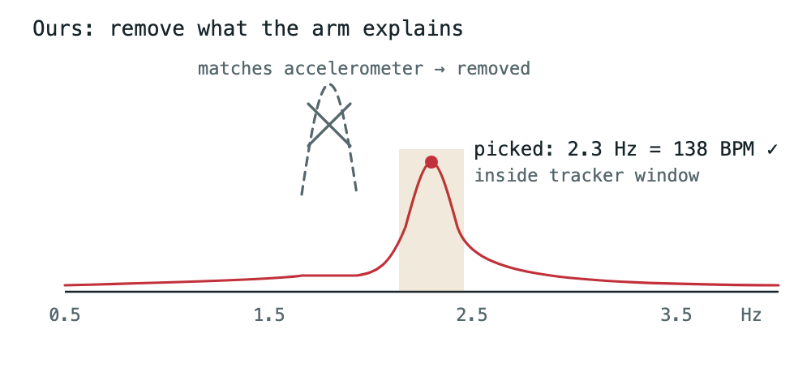

# Motion-Robust Heart Rate Estimation from Wrist PPG

**Accelerometer-Aided Spectral Filtering and Signal Quality Gating**

A smartwatch estimates heart rate by shining light into the wrist and measuring how much comes back.
This works when the arm is still and often fails when it moves, because the movement adds its own
rhythm to the signal. This project builds a software-only pipeline that uses the wrist accelerometer
to find and remove the motion rhythm, tracks heart rate between windows, and flags windows that are
too poor to trust. Every stage is evaluated against ECG-derived heart rate on the public
**PPG-DaLiA** dataset using leave-one-subject-out (LOSO) cross-validation.

> Status: planning / scaffolding. No experiments have been run yet; all result tables are placeholders.
> This is a student project and is **not** clinically validated.

The full project plan (background, problem statement, literature, step-by-step method, evaluation
plan, limitations and references) is in [`docs/project_plan.md`](docs/project_plan.md).

## Dataset: PPG-DaLiA

We use **PPG-DaLiA** (Reiss et al., *Sensors* 2019), a public dataset for PPG-based heart rate
estimation during daily life. It is available from the UCI Machine Learning Repository.

| | |
|---|---|
| Subjects | 15 (Fitzpatrick skin types II–IV) |
| Duration | about 2.5 h per subject, ~65 000 windows in total (S6: first 90 min only) |
| Wrist device | Empatica E4: PPG (BVP) at 64 Hz, 3-axis accelerometer at 32 Hz |
| Chest device | RespiBAN: ECG at 700 Hz |
| Ground truth | HR from hand-corrected ECG R-peaks, one value per 8 s window with a 2 s shift |
| Activities | sitting, stairs, table soccer, cycling, driving, lunch, walking, working, plus transitions |
| HR range | 41–187 BPM |

Why this dataset: the wrist PPG and accelerometer come from the same watch, the ECG reference
is accurate, and the activities include both rest and natural movement. The original paper
also argues for leave-one-subject-out evaluation and publishes classical baselines (SpaMa
15.56, SpaMaPlus 11.06 BPM MAE), so we have a reference point. Download instructions are in
[`data/README.md`](data/README.md).

## Figures

**Reflectance PPG: what the sensor sees**



**Circuit of a typical PPG front end.** This is a representative design, not the Empatica E4's
internal circuit, which is not published. Component labels are generic.



**Our proposed pipeline**



**Why accelerometer-aided peak removal helps** (illustration, not measured data)

| Normal estimator | Our pipeline |
|---|---|
|  |  |

SVG versions of every figure are in [`docs/figures/`](docs/figures/) for use in the report.

## Pipeline

| Stage | Method | Module |
|---|---|---|
| Pre-processing | 0.5–4 Hz zero-phase Butterworth band-pass, AC/DC/noise split, z-normalisation | `src/ppg_hr/preprocess.py` |
| Stage 0 | FFT spectral-peak baseline, HR = 60 × f | `src/ppg_hr/stages/baseline.py` |
| Stage 1 | NLMS adaptive noise cancellation with accelerometer reference (experiment) | `src/ppg_hr/stages/nlms.py` |
| Stage 2 | SpaMa-style removal of accelerometer-matched spectral peaks | `src/ppg_hr/stages/spectral_removal.py` |
| Stage 3 | HR tracking and verification rules | `src/ppg_hr/stages/tracking.py` |
| Stage 4 | Signal-quality gating: power ratio, perfusion index, AC SNR | `src/ppg_hr/stages/quality.py` |
| Optional | Compact ~26K-parameter CNN, int8 post-training quantization | `src/ppg_hr/cnn.py` |

Evaluation (`src/ppg_hr/evaluate.py`): LOSO over 15 subjects, MAE (overall / per subject /
per activity), Pearson correlation, Bland-Altman limits of agreement, and coverage. Stages are
added cumulatively as an ablation.

## Repository layout

```
docs/            project plan and report
data/            PPG-DaLiA goes here (git-ignored, see data/README.md)
src/ppg_hr/      pipeline code
notebooks/       exploration and figures
results/         tables and figures generated by experiments
tests/           sanity checks (synthetic signals, filter checks)
```

## Setup

```bash
python -m venv .venv
source .venv/bin/activate
pip install -r requirements.txt
```

Then download PPG-DaLiA into `data/` as described in [`data/README.md`](data/README.md).

## Project progress

**Current phase:** planning complete, starting implementation (Step 1). No experimental results yet.

### Phase 0 – Planning and setup

- [x] Literature review of 7 papers (summary table in [`docs/project_plan.md`](docs/project_plan.md))
- [x] Problem statement and research question defined
- [x] Full project plan written (13 steps, evaluation plan, limitations)
- [x] Dataset chosen: PPG-DaLiA
- [x] GitHub repository and code structure set up
- [x] Sensor circuit, optical path and pipeline diagrams ([`docs/figures/`](docs/figures/))
- [x] Python environment set up (NumPy, SciPy, Matplotlib, pandas, scikit-learn)
- [x] PPG-DaLiA downloaded (2.7 GB)

### Implementation roadmap

- [ ] Step 1 – Load and inspect PPG-DaLiA *(in progress: loader and exploration script written, not yet run)*
- [ ] Step 2 – Synchronise and window (8 s, 2 s shift)
- [ ] Step 3 – Pre-process
- [ ] Step 4 – Stage 0 baseline
- [ ] Step 5 – Stage 1 NLMS
- [ ] Step 6 – Stage 2 spectral motion-peak removal
- [ ] Step 7 – Stage 3 tracking and verification
- [ ] Step 8 – Stage 4 quality gating
- [ ] Step 9 – Peak-detection sanity check
- [ ] Step 10 – LOSO evaluation and ablation
- [ ] Step 11 – (optional) Compact CNN
- [ ] Step 12 – (optional) int8 quantization and edge metrics
- [ ] Step 13 – (optional) CNN + gate + tracking

## Key references

1. A. Reiss et al., "Deep PPG: Large-scale heart rate estimation with convolutional neural networks," *Sensors*, 2019.
2. Z. Zhang, Z. Pi, B. Liu, "TROIKA," *IEEE TBME*, 2015.

See [`docs/project_plan.md`](docs/project_plan.md#11-references) for the full list.
