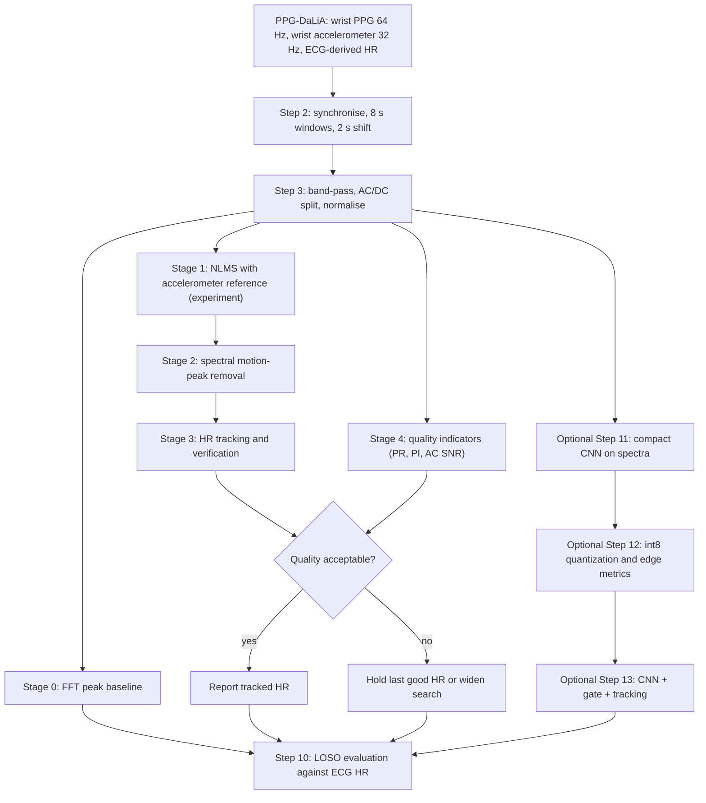

# Project Plan

## Paper summary table (prepared before writing)

| # | Paper | Main contribution | Where it is used in our report | Caveat |
|---|---|---|---|---|
| [1] | Reiss et al., "Deep PPG" (Sensors, 2019) | The PPG-DaLiA dataset (15 subjects, 8 daily-life activities, 8 s windows with 2 s shift); the argument for leave-one-session-out (LOSO) evaluation; SpaMa, SpaMaPlus and Schaeck2017 benchmarks; a large CNN and a compact 26K-parameter CNN | Sections 4, 5, 8, 9; Steps 1, 2, 4, 6, 7, 10, 11, 12, 13 | No running in the protocol; skin types II-IV only; full SpaMa details are in a paper we do not have; the 32 KB / 8-bit figure is a design assumption, the paper does not report the accuracy of a quantized model |
| [2] | Zhang, Pi, Liu, "TROIKA" (IEEE TBME, 2015) | Problem definition for wrist PPG in intense exercise; three-part framework (signal decomposition, sparse high-resolution spectrum, peak tracking with verification); ablation; error, Bland-Altman and Pearson evaluation | Sections 4, 5, 10; Steps 2, 3, 5, 7, 10 | 12 male subjects, about 5 minutes each, treadmill only; parameters set by heuristics; no cross-validation is described |
| [3] | Chinenye and Bobrova (NeuroNT, 2026) | Motion-artifact classification on PPG-DaLiA; proxy clean/artifact labels from HR disagreement and motion intensity; LOSO comparison of 1D-CNN, CNN-GRU and STFT-ResNet | Section 5; Step 8 (optional learned gate); Step 11 | Labels are heuristic and need the ECG reference; models use PPG only; layer sizes are not given |
| [4] | Fu et al. (IEEE Sensors, 2025) | Frequency-domain power ratio (PR) as a segment-level quality metric for wrist PPG; threshold 0.592 | Section 5; Steps 3, 8 | Tested on low-motion segments only, at 25 Hz with 10.2 s windows; fixed band fails above 150 BPM; the AUC is printed with two different values |
| [5] | Kong and Hedayatipour (DCAS, 2025) | A complete PPG pipeline: extraction, DTW-based signal quality index, pyPPG fiducial points and 102 features | Section 5; Step 8 (optional SQI); Step 9 | ICU data (MIMIC-III), 60 s segments, not real-time; segment counts disagree inside the paper |
| [6] | Kumar et al., "PI-PPG" (BSN, 2025) | Hardware (polarized light) approach to motion, ambient light and skin-tone problems; AC/DC/noise filter definitions; perfusion index and AC SNR formulas | Sections 4, 5; Steps 3, 8 | Hardware study, not comparable with our software results; how AC, DC and noise amplitudes are measured is not stated; some percentage claims are unclear |
| [7] | Sruthi et al., "Inverted PPG with window sampling" (iSES, 2025) | Low-power window sampling; peak detection by thresholding and by derivative; the false pulses these can create | Section 5; Steps 9, 12 | Evidence is a simulation on one 10 s abnormal segment, not a wearable test |

---

# 1. Title and plain-language summary

**Motion-Robust Heart Rate Estimation from Wrist PPG Using Accelerometer-Aided Spectral Filtering and Signal Quality Gating**

(If the optional extension is completed, the title becomes: "... and Signal Quality Gating and a Compact Int8-Quantized CNN".)

A smartwatch shines light into the wrist and measures how much comes back. The amount changes slightly with every heartbeat, and the watch turns that into a heart rate. This works when the arm is still and often fails when the arm moves, because the movement adds its own rhythm to the signal. We plan to fix this in software only. We use the watch's motion sensor to find the movement rhythm, remove it, follow the heart rate from one moment to the next, and mark the moments when the signal is too poor to trust. Every stage will be checked against a heart rate taken from a chest ECG in a public dataset. This document is a plan written before any experiment; it contains no results of our own.

# 2. Abstract

Photoplethysmography (PPG) is an optical method that senses blood-volume changes in tissue and is the basis of wrist heart-rate monitors. During movement the wrist PPG signal is corrupted by motion artifacts, and simple heart-rate estimators lock onto the movement rhythm instead of the pulse. We plan a software pipeline that estimates heart rate from 8-second windows of wrist PPG with the help of a wrist accelerometer. The pipeline has five cumulative stages: a spectral-peak baseline, adaptive noise cancellation with a normalized least-mean-squares (NLMS) filter, removal of accelerometer-matched peaks from the PPG spectrum, heart-rate tracking with verification rules, and signal-quality gating based on a power ratio, a perfusion index and a signal-to-noise ratio. We will evaluate every stage on the public PPG-DaLiA dataset against ECG-derived heart rate, using leave-one-subject-out cross-validation, mean absolute error, Pearson correlation, Bland-Altman analysis and coverage. As an optional extension we will train a compact convolutional neural network, quantize it to 8-bit integers, and measure the accuracy change and model size. No experiment has been run yet; all result tables contain placeholders. The work is a student study and is not clinically validated.

# 3. Background

**What PPG is.** Photoplethysmography (PPG) is a non-invasive optical technique. A light-emitting diode (LED) lights the skin and a photodetector measures the light that returns. Blood absorbs light, so the detected light changes with each heartbeat.

**AC and DC.** The PPG signal has two parts. The DC component is the large, slowly changing part caused by tissue and venous blood. The AC component is the small pulsing part caused by arterial blood; it is only a few percent of the DC.

**Waveform.** One pulse has a systolic peak (the main peak), a dicrotic notch (a small dip) and a diastolic wave (a smaller second bump).

**Frequency content.** At rest the heartbeat sits at about 0.8-2 Hz, breathing at 0.15-0.4 Hz, and baseline drift below 0.1 Hz. A practical heart-rate band-pass filter (a filter that keeps one range of frequencies) is about 0.5-4 Hz.

**Heart rate.** In the time domain, HR = 60/T, where T is the time between two peaks in seconds. In the frequency domain, HR = 60 x f, where f is the dominant frequency in Hz. HR is given in beats per minute (BPM).

**Sensor types.** Transmission PPG shines light through a thin body part (fingertip, earlobe). Reflectance PPG has the LED and the detector on the same side (wrist, forehead) and is what smartwatches use.

**Known limitations.** Motion artifacts, ambient light, sensor pressure and placement, and skin and tissue properties.

# 4. Problem statement

**What goes wrong.** A motion artifact is any change in the PPG signal caused by movement and not by blood flow. On the wrist the artifact is strong because the wrist is flexible and the sensor sits loosely on the skin [2]. The artifact comes from changes in the gap between the skin and the sensor [2]. During rhythmic movement the artifact is itself periodic, so the PPG spectrum shows a movement peak that can be larger than, and very close to, the heartbeat peak [2]. A method that simply picks the largest peak then reports the arm rhythm as the heart rate.

**Evidence from the papers (published results, not ours).** On PPG-DaLiA, the best classical method tested in [1] (SpaMaPlus) has a mean absolute error of 4.27 BPM while sitting but 25.42 BPM on stairs, 21.48 BPM in table soccer and 18.16 BPM while walking [1, Table 11]. The authors of [1] also report that errors look small only when parameters are tuned for each recording, and grow a lot when the method is tested on unseen recordings. Paper [3] describes motion disturbance as one of the main barriers to reliable wearable monitoring, and [6] notes that conventional sensors lose signal integrity during physical activity.

**Why it matters.** Heart rate during activity is exactly when a fitness or health user wants a reading. A wrong reading that looks confident is worse than no reading, so the device should also know when not to trust itself.

**Our question.** How much can accelerometer-aided spectral filtering, tracking and quality gating reduce the heart-rate error of a simple spectral estimator on PPG-DaLiA, measured stage by stage on subjects the method has not seen?

# 5. Existing approaches and their gaps

**Hardware (PI-PPG [6]).** The authors place polarizers in the light path so that light reflected from the skin surface is rejected and deeper, pulse-carrying light is kept. They report better signal quality and lower heart-rate error during motion and on darker skin. This needs new optics; it cannot help the millions of sensors already built, and some error remains, so software is still needed. We do not compare our numbers with theirs.

**Classical signal processing (TROIKA [2], SpaMa [1]).** TROIKA cleans the signal by decomposition, estimates a high-resolution spectrum and tracks the heart-rate peak with verification rules. SpaMa, as described in [1], removes accelerometer peaks from the PPG spectrum. Both depend on hand-set parameters; [1] shows that such methods lose much accuracy on unseen sessions.

**Quality assessment (Fu et al. [4], Kong and Hedayatipour [5]).** Fu et al. show that a simple power ratio separates good from bad wrist segments, but only test low-motion data with a fixed band. Kong and Hedayatipour use a template-matching quality index to keep only excellent segments of ICU recordings. Neither studies quality gating inside a heart-rate estimator during daily activity.

**Deep learning (Deep PPG [1], Chinenye and Bobrova [3]).** Deep PPG feeds PPG and accelerometer spectra to a CNN and beats the classical methods on PPG-DaLiA, at a high computing cost; a compact version is proposed for embedded use. Chinenye and Bobrova classify windows as clean or artifact. Their labels are heuristic and their models do not use the accelerometer.

**Low-power sampling (iSES [7]).** The LED dominates sensor energy use, so the paper studies switching it on only in short windows around predicted peaks. It shows that simple peak detectors create false pulses. The evidence is a small simulation.

**The gap we address.** A transparent, stage-by-stage measurement of simple, explainable methods under a strict unseen-subject protocol, with error always reported together with how many windows were accepted.

# 6. Our proposed solution

Why each stage exists:

1. **Pre-processing** removes baseline drift and breathing (slides: content below 0.5 Hz) and high-frequency noise.
2. **Stage 0 (baseline)** is the simple spectral rule from the slides, HR = 60 x dominant frequency. It gives the reference error that later stages must improve.
3. **Stage 1 (NLMS)** tests the classical idea of subtracting a motion reference. TROIKA warns that this depends on the reference quality [2], so we treat it as an experiment.
4. **Stage 2 (spectral peak removal)** addresses the slide limitation "motion artifacts" directly: peaks that also appear in the accelerometer spectrum are treated as movement [1].
5. **Stage 3 (tracking)** uses the fact that heart rate changes slowly between overlapping windows [1], [2], so a sudden jump is probably an error.
6. **Stage 4 (quality gating)** handles windows where no heartbeat component is visible at all, a case TROIKA shows can happen [2], and other slide limitations such as poor contact.

# 7. Step-by-step implementation plan

In every step, "what the papers did" is cited; everything else is what we plan to do. Core work is Steps 1-10. Steps 11-13 are optional.

## Step 1. Set up and understand the data

- **Goal:** Have all signals loaded and understood before any processing.
- **Input:** PPG-DaLiA download (about 2.7 GB [CHECK size on download]).
- **What we do:** Install Python with NumPy, SciPy, Matplotlib and scikit-learn (PyTorch or TensorFlow/TFLite only for the extension; pyPPG optional). For each of the 15 subjects we load the wrist PPG (64 Hz), the wrist 3-axis accelerometer (32 Hz), the chest ECG (700 Hz), the activity labels and the provided ground-truth HR [1]. In [1] the wrist device is an Empatica E4 on the non-dominant wrist and the chest device is a RespiBAN. Ground truth was made by detecting ECG R-peaks, correcting them by hand, and averaging the instantaneous heart rate over each 8 s window [1]. We plot 30 s of PPG, accelerometer and HR for sitting, walking and table soccer.
- **Output:** One data structure per subject and a set of labelled plots.
- **How we check it is correct:** Signal lengths divided by sampling rates give the same duration; the number of ground-truth values matches the number of windows in Step 2; ground truth lies within the published range of 41-187 BPM [1]; the total number of windows is close to the roughly 65 thousand reported in [1].
- **Common pitfalls:** Subject S6 has only the first 90 minutes valid [1]. Exact file field names are not in the paper; read the dataset documentation [CHECK].
- **What motion artifact looks like:** At rest the PPG is a regular train of similar pulses. During movement the amplitude swings become several times larger, the pulses lose their shape, and the swings line up in time with bursts in the accelerometer.
- **Supporting paper:** [1].

## Step 2. Synchronise and window

- **Goal:** Cut all signals into aligned windows, each with one reference HR and one activity label.
- **Input:** Signals from Step 1.
- **What we do:** We use 8 s windows shifted by 2 s. This gives 512 PPG samples and 256 accelerometer samples per window, as also noted in [3]. The values match the ground truth in [1] and TROIKA's T = 8 and S = 2 [2]. TROIKA explains that a longer window gives better frequency resolution and a short shift keeps successive estimates close [2]. An 8 s window has a natural resolution of 1/8 Hz, which is 7.5 BPM; this is why later steps compute the spectrum on a finer grid. For frequency-domain stages we do not need equal sampling rates, only equal frequency grids: zero-padding (adding zeros before the FFT) to 4096 points at 64 Hz and 2048 points at 32 Hz both give a spacing of 0.0156 Hz, about 0.94 BPM (our calculation). For the time-domain NLMS stage we resample the accelerometer to 64 Hz with a polyphase resampler. Each window gets the activity label that covers most of it; windows that span two activities are flagged.
- **Output:** Arrays of PPG windows, accelerometer windows, reference HR, activity label and a "mixed-label" flag.
- **How we check it is correct:** Window count equals the ground-truth count for every subject; the sitting section shows low accelerometer variance; shifting the alignment by one window makes the baseline error worse, not better.
- **Common pitfalls:** Sampling-rate mismatch (PPG and accelerometer differ by a factor of 2); window misalignment by one step; transition periods, which are labelled separately in the dataset and form a large share of the windows [1]. In [1] the two devices were synchronised by hand using a double-tap gesture, so small residual offsets are possible.
- **Supporting papers:** [1], [2], [3].

## Step 3. Pre-process

- **Goal:** Keep the heartbeat band, separate AC from DC, and put all windows on the same scale.
- **Input:** Windows from Step 2.
- **What we do:** We band-pass the PPG at 0.5-4 Hz with a zero-phase Butterworth filter (a standard smooth filter applied forwards and backwards so that it adds no delay; this is an offline choice). The papers used different bands: TROIKA 0.4-5 Hz [2], PI-PPG 0.75-4 Hz for AC [6], Fu et al. 0.5-5 Hz [4], iSES 0.5-20 Hz [7]. We justify 0.5-4 Hz as follows: the dataset's HR range of 41-187 BPM is 0.68-3.12 Hz, which fits inside with margin; 0.75 Hz (45 BPM) would cut the lowest rates; 0.4 Hz lets in more breathing; an upper edge of 20 Hz is useful for pulse shape, which we do not need for spectral HR. The accelerometer gets the same band-pass, as TROIKA does [2]. Following PI-PPG, DC is obtained with a 0.1 Hz low-pass filter and the noise component with a 10 Hz high-pass filter [6]. Finally each window is z-normalised (subtract its mean, divide by its standard deviation).
- **Output:** Filtered PPG and accelerometer windows; AC, DC and noise components.
- **How we check it is correct:** Plot the filter's frequency response; plot one resting window before and after filtering; confirm the resting spectrum has one clear peak near the reference HR.
- **Common pitfalls:** Filtering each short window separately causes edge effects, so we filter the continuous signal first and then cut windows. The PR metric in Step 8 needs a 0.5-5 Hz copy, not the 0.5-4 Hz one. The E4 PPG output is described in [1] as a difference signal, so it may contain no true DC level [CHECK]; if so, the perfusion index cannot be computed properly on this dataset.
- **Supporting papers:** [2], [4], [6], [7].

## Step 4. Stage 0: baseline heart-rate estimate

- **Goal:** A simple reference estimator.
- **Input:** Pre-processed PPG windows.
- **What we do:** We compute the FFT (Fast Fourier Transform, an algorithm that shows how much of each frequency a signal contains) of each window on the fine grid of Step 2. We search 0.67-3.33 Hz (40-200 BPM), which covers the dataset's 41-187 BPM [1], take the largest peak at frequency f, and set HR = 60 x f. The error measure is the mean absolute error (MAE), as defined in [1]:

  MAE = (1/W) x sum over w = 1..W of | HR_est(w) - HR_ref(w) |

  where W is the number of windows, HR_est is our estimate and HR_ref is the ECG-derived reference. We compute MAE per subject and per activity.
- **Output:** One HR per window; baseline MAE tables.
- **How we check it is correct:** A synthetic 1.5 Hz sine wave must return 90 BPM; error during sitting should be clearly lower than during stairs or table soccer.
- **Common pitfalls:** Picking the second harmonic (twice the true rate); picking a breathing-related peak at the low edge; believing zero-padding improves true resolution (it only gives a finer grid). TROIKA explains that the plain FFT spectrum suffers from leakage, where a strong peak smears over a weak neighbour [2]. This stage is expected to be poor during motion.
- **Supporting papers:** [1], [2], [3].

## Step 5. Stage 1: adaptive motion cancellation (an experiment, not an assumption)

- **Goal:** Test whether subtracting an accelerometer-based estimate of the artifact helps.
- **Input:** Continuous filtered PPG and accelerometer at 64 Hz.
- **What we do:** An adaptive filter is a filter whose coefficients change over time to reduce an error. NLMS means normalized least mean squares. In simple terms: the filter takes the last L accelerometer samples x(n), forms a weighted sum y(n) = w . x(n) as its guess of the artifact, and subtracts it from the PPG d(n) to give e(n) = d(n) - y(n). The weights are then nudged: w <- w + mu x e(n) x x(n) / (eps + |x(n)|^2). The cleaned PPG is e(n). (This is the standard textbook form, not taken from the attached papers.) The step size mu sets how fast the filter adapts; the filter length L sets how much motion history it uses. We test the three axes (one filter per axis in cascade) and the magnitude as references. mu and L are tuned on training subjects only.
- **Output:** A cleaned PPG; MAE of "baseline + NLMS".
- **How we check it is correct:** Add a known scaled copy of the accelerometer to a clean resting window and confirm the filter removes it; confirm the filter does not change clean resting data much.
- **Common pitfalls:** Too large a step size makes the filter unstable; when the arm rhythm and the heart rate coincide the filter can remove the heartbeat.
- **Honest limitation from TROIKA:** Adaptive noise cancellation is sensitive to its reference signal, and a good reference is hard to obtain during exercise [2]. Accelerometer data describe hand movement in space, while the artifact comes from the changing skin-sensor gap, so with irregular movement the accelerometer may explain only part of the artifact [2]. We report whether this stage helps; we do not assume it does.
- **Supporting paper:** [2].

## Step 6. Stage 2: spectral motion-peak removal (SpaMa-style)

- **Goal:** Remove movement peaks from the PPG spectrum.
- **Input:** PPG windows (with or without Stage 1) and accelerometer windows.
- **What we do:** As described in [1], SpaMa computes the power spectral density (power at each frequency) of the PPG and accelerometer for each window, finds the highest peaks in each, treats the accelerometer peaks as motion, removes them from the PPG spectrum, and takes the highest remaining PPG peak as the heart rate. We implement this idea: take the K_a strongest accelerometer peaks over the three axes and the K_p strongest PPG peaks; delete any PPG peak within delta Hz of an accelerometer peak; HR = 60 x frequency of the strongest remaining peak. If nothing remains we keep the Stage 0 peak and flag the window. The parameters named in [1], the number of peaks considered and the minimum frequency difference, are tuned on training subjects only.
- **Output:** A list of candidate peaks per window and the Stage 2 HR.
- **How we check it is correct:** For one hard window, plot the PPG spectrum, the accelerometer spectrum, the removed peaks and the reference HR.
- **Common pitfalls:** If the heart rate equals the step rate or its harmonic, the true peak is deleted. TROIKA handles this by protecting a small band (about 0.3 Hz in their setup) around the previous heart rate [2]; we add the same protection once Stage 3 exists. The paper [1] notes that SpaMa-type methods are very sensitive to parameter settings.
- **Supporting papers:** [1], [2]. Our code is "SpaMa-style", not a verified copy, because the original algorithm paper is not among our sources.

## Step 7. Stage 3: heart-rate tracking and verification

- **Goal:** Use recent history to choose the right peak and stop errors from spreading.
- **Input:** Candidate peaks from Stage 2.
- **What we do, rule by rule:**
  1. **Initialise.** Start from the first reliable window. TROIKA asks the wearer to keep still for a few seconds and takes the highest peak [2]. PPG-DaLiA starts with sitting [1], which gives a natural start.
  2. **Predict.** The predicted HR is the mean of the last six estimates, as in SpaMaPlus [1]. Plainly: the heart cannot change rate instantly, so the recent average is a good guess.
  3. **Select.** Choose the candidate peak closest to the prediction [1].
  4. **Limit jumps.** TROIKA observes that HR rarely changes by more than about 10 BPM between successive windows; if the selected peak jumps further, it moves the estimate only a small step in that direction [2]. We do the same with a threshold tuned on training subjects.
  5. **No peak found.** Keep the previous value, as TROIKA does [2]. TROIKA also widens its search range after three such windows in a row [2]; we do the same.
  6. **Reset.** SpaMaPlus restarts tracking when the difference between current and previous estimates exceeds a threshold (for example 10 BPM) several consecutive times (for example three) [1]. Plainly: if the tracker keeps disagreeing with the data, it is probably lost and should start again.
- **Output:** A tracked HR per window and a log of which rule fired.
- **How we check it is correct:** Plot estimate against reference over one whole subject; inject an artificial wrong peak and confirm recovery within a few windows.
- **Common pitfalls:** Rule 4 hides the jumps that rule 6 needs to see, so rule 6 must test the raw selected peak, not the limited output. Averaging lags behind fast HR changes, which [1] reports as a weakness of SpaMaPlus. A wrong start is carried forward.
- **Not implemented in the core plan:** TROIKA's singular spectrum analysis (SSA) splits the PPG into components and drops those whose main frequencies match strong accelerometer frequencies; its sparse signal reconstruction (SSR) computes a sharper spectrum that can separate two close peaks which the FFT merges [2]. TROIKA's ablation shows large failures on some subjects when either is removed [2]. They are more complex and are left as future work.
- **Supporting papers:** [1], [2].

## Step 8. Stage 4: signal quality gating

- **Goal:** Score each window and avoid trusting bad ones.
- **Input:** Filtered windows, AC/DC/noise components, tracked HR.
- **What we do:** A signal quality index (SQI) is a number that says how usable a segment is. We compute:
  1. **Power ratio (PR)** [4]. Fu et al. band-pass at 0.5-5 Hz, compute Welch's power spectral density (an averaged, smoother spectrum), and define PR = power in 0.5-2.5 Hz (30-150 BPM) divided by total power in 0.5-5 Hz. Their threshold is 0.592, chosen conservatively [4]. We use it only as a starting value and re-tune on training subjects, because their data were 25 Hz, 10.2 s, low-motion segments. Their stated failure case is a participant with resting HR above 150 BPM, whose pulse power fell outside the band [4]. This matters to us: PPG-DaLiA has reference HR up to 187 BPM and at least 551 windows at 160 BPM or more [1, Table 2]. Our proposed fix is an adaptive PR whose "cardiac band" is centred on the tracked HR; Fu et al. themselves suggest adaptive ranges [4].
  2. **Perfusion index** PI = AC/DC x 100 and **AC SNR** = 20 log10(AC/Noise) in dB [6], with AC from a 0.75-4 Hz band-pass, DC from a 0.1 Hz low-pass and noise from a 10 Hz high-pass [6]. The paper does not say how the amplitudes are measured; we use root-mean-square for AC and noise and the mean for DC, and state this as our choice. Fu et al. note that PI predicts quality poorly at the wrist [4], so we treat PI as a secondary indicator.
  3. **Optional:** the DTW-based SQI in pyPPG (DTW, dynamic time warping, compares each pulse with a template while allowing small timing stretches). Kong and Hedayatipour use the classes excellent (90% or more), acceptable (70-90%) and unfit (below 70%) [5].
  4. **Optional learned gate:** label training windows with the rule of [3]. Motion intensity is the standard deviation of the accelerometer magnitude in the window, z-scored within each subject; HR disagreement is the absolute difference between the FFT estimate and the ECG reference. Clean: disagreement at most 5 and motion z-score at most 0.5. Artifact: disagreement at least 10 and motion z-score at least 1.0. Others are ambiguous and left out of training [3]. This rule uses the ECG-referenced HR error, so it cannot be used at deployment time without a reference and must be evaluated carefully.
- **Gating policy:** If quality is below the threshold, we hold the last good HR (or widen the tracking search). Holding changes the result, so we always report MAE together with coverage, the fraction of windows accepted. We report both MAE on accepted windows and MAE on all windows with held values.
- **Output:** Quality scores, an accept/reject flag, the gated HR and coverage.
- **How we check it is correct:** Rejected windows should have higher Stage 3 error than accepted ones on training subjects; plot MAE against coverage as the threshold moves.
- **Common pitfalls:** Rhythmic arm movement at 0.5-2.5 Hz puts motion power inside the "cardiac" band, so PR can be high on a bad window; Fu et al. also found bad segments with high PR [4]. A band centred on the tracked HR is circular: if the tracker is wrong, the score can still look good. A gate that rejects nearly everything gives a low MAE that means little.
- **Supporting papers:** [3], [4], [5], [6].

## Step 9. Peak-detection and feature sanity check

- **Goal:** Explain why we do not count peaks, and check pulse shape on good windows.
- **Input:** A few high-quality and low-quality windows.
- **What we do:** The iSES paper turns the PPG into a pulse train in two ways: by a fixed threshold on the signal and by a threshold on its derivative (slope) [7]. In its simulated 10 s example with 13 true beats, thresholding gave 14 pulses and the derivative method gave 19 [7]. The extra pulses come from the dicrotic notch and the diastolic peak being counted as beats [7]. For beat-by-beat work this is serious: one false pulse splits a beat interval in two, so the inter-beat interval (time between beats) and any variability measure built on it become wrong. Our spectral approach never counts individual beats; it looks for the repetition rate over 8 s, so a notch only adds a harmonic, which the search band and tracking handle. We reproduce the two detectors on a few windows to show the effect. Optional: use pyPPG to extract a few shape features on accepted windows only, as Kong and Hedayatipour do after quality filtering [5].
- **Output:** Figures of true and false peaks; optional feature table.
- **How we check it is correct:** Count detected pulses against 8 s x reference HR / 60.
- **Common pitfalls:** pyPPG was applied in [5] to 60 s ICU segments; our 8 s windows may be too short, so consecutive accepted windows may need joining [CHECK].
- **Supporting papers:** [5], [7].

## Step 10. Evaluate the classical pipeline properly

- **Goal:** A fair measurement of every stage.
- **Input:** Outputs of Stages 0-4 for all subjects.
- **What we do:**
  1. **Protocol.** Leave-one-subject-out: 15 folds; in each, one subject is the test set and all tuning uses the other 14. Paper [1] calls this leave-one-session-out and notes that in PPG-DaLiA sessions and subjects are the same thing. The reason is given in [1]: in real use there is no reference to tune against, so per-session tuning gives misleadingly optimistic errors.
  2. **Metrics.** MAE overall, per subject and per activity; Pearson correlation (a number from -1 to 1 measuring how well estimates follow the reference); a Bland-Altman plot (difference against average for each window) with limits of agreement, mean difference +/- 1.96 standard deviations, as in TROIKA [2]; and coverage.
  3. **Ablation.** An ablation is an experiment that shows what each part contributes. TROIKA removes one part at a time from its full system [2]. We add stages cumulatively: baseline, + NLMS, + spectral removal, + tracking, + gating. If NLMS does not help, we also report the chain without it.
  4. **Plots.** Spectrum before and after motion-peak removal for one hard window; estimate against reference for one subject over the whole protocol; Bland-Altman for the best configuration.
- **Output:** The filled table of Section 8(a) and the three plots.
- **How we check it is correct:** Re-run one fold from scratch and get the same numbers; confirm no parameter was ever chosen using the test subject.
- **Reference numbers (published results, not ours).** On PPG-DaLiA under LOSO: SpaMa 15.56, SpaMaPlus 11.06 and Schaeck2017 20.45 BPM MAE [1]. TROIKA reports 2.34 BPM on its own recordings: 12 subjects, about 5 minutes each, on a treadmill, at 125 Hz [2].
- **Why these are not comparable.** The datasets differ in size, activities (regular running against aperiodic daily tasks), sensors and sampling rate. The ground truth is built differently (beat counting in [2], mean instantaneous rate in [1]). TROIKA's parameters were set on the same recordings it reports, and no held-out protocol is described [2]. A simple pipeline under LOSO should not be expected to match TROIKA's treadmill result.
- **Common pitfalls:** Tuning on all 15 subjects "just once"; forgetting transition windows, which the published overall figures include [1].
- **Supporting papers:** [1], [2].

## OPTIONAL EXTENSION

## Step 11. Compact CNN for HR estimation (optional)

- **Goal:** Test whether a very small learned model can replace Stages 1-3.
- **Input:** Windows from Step 2.
- **What we do:** A convolutional neural network (CNN) is a model that learns small pattern detectors and slides them along its input. Following [1]: FFT of each 8 s window for the PPG and the three accelerometer channels, keep 0-4 Hz, z-normalise each channel; the input is 4 channels x 257 frequency points. The compact architecture in [1] is: a 1x1 convolution with 8 filters that fuses the channels, followed by max-pooling (which halves the length); three blocks of 1x3 convolution plus max-pooling with 16, 32 and 64 filters; a last 1x1 convolution with 16 filters; flattening; a dense (fully connected) layer of 64 neurons; one output neuron giving HR. It uses ELU activation, absolute-error loss, the Adam optimiser, no dropout and no ensemble, and has about 26K parameters [1]. Our own count of these layers gives 25,769 [CHECK]. We train under LOSO; inside each fold some training subjects form a validation set. Our starting settings: at most 100 epochs, early stopping (stop when validation error has not improved for 10 epochs), learning rate 0.001. These are our choices; [1] does not give them for this model.
- **Reference numbers (published, not ours):** 9.99 BPM MAE for the constrained model against 7.65 BPM for the large seven-model ensemble on PPG-DaLiA [1].
- **Optional:** a 1D-CNN or CNN-GRU artifact classifier trained on the proxy labels as a learned quality gate; [3] used Adam, learning rate 0.001, early stopping, class weights and a decision threshold of 0.5.
- **Output:** 15 trained models and their test MAE.
- **How we check it is correct:** Parameter count near 26K; training loss falls; the test subject never appears in training or validation.
- **Common pitfalls:** Normalising with statistics that include the test subject; expecting the published number, which came from long training on GPUs [1]; whether the compact model keeps batch normalisation is not stated [CHECK].
- **Supporting papers:** [1], [3].

## Step 12. Post-training int8 quantization and edge metrics (optional)

- **Goal:** Measure what compression costs in accuracy.
- **Input:** Trained float32 models.
- **What we do:** Quantization stores numbers with fewer bits; int8 means 8-bit integers instead of 32-bit floating point. Post-training quantization converts a finished model without retraining, using a small calibration set taken from training subjects. We report parameter count, file size in KB, operations per inference, CPU latency on our own machine, and the MAE change from float32 to int8. In [1] the 32 KB target comes from assuming 8-bit parameters fitting one memory block, hence at most 32K parameters; the paper reports about 190K computations per second for the compact model [1].
- **Output:** The filled table of Section 8(b).
- **How we check it is correct:** Run float and int8 models on the same windows and compare outputs one by one.
- **Common pitfalls:** The model file includes overhead, so 26K parameters does not guarantee a file under 32 KB; the FFT pre-processing also costs memory and time and must be stated separately. Latency is measured on a laptop/PC and is not a wearable measurement.
- **Low-power motivation only:** [7] states that LED on-time dominates sensor energy and studies window sampling to cut it. We do not implement or measure this.
- **Supporting papers:** [1], [7].

## Step 13. Combine everything (optional)

- **Goal:** One final comparison.
- **What we do:** Hybrid option: the CNN estimate passed through the Stage 4 gate and Stage 3 tracking rules. We then assemble the final results table, discuss what worked and what did not (including stages that made things worse), and list limitations.
- **Output:** Final tables and discussion.
- **How we check it is correct:** Every number in the tables can be regenerated from saved per-window outputs.
- **Common pitfalls:** Choosing the "best" combination using test-subject results.
- **Supporting papers:** [1], [2], [4].

# 8. Evaluation plan

**Protocol.** Leave-one-subject-out over the 15 subjects; all tuning on training subjects only (Step 10).

**Metrics.** MAE (overall, per subject, per activity), Pearson correlation, Bland-Altman limits of agreement, coverage. For the extension: parameters, size, latency, float-to-int8 MAE change.

**Results templates.** [TBF] means [TO BE FILLED AFTER EXPERIMENTS].

(a) Cumulative ablation, MAE in BPM

| Method | MAE overall | Sitting | Stairs | Table soccer | Cycling | Driving | Lunch | Walking | Working | Coverage |
|---|---|---|---|---|---|---|---|---|---|---|
| Stage 0: baseline | [TBF] | [TBF] | [TBF] | [TBF] | [TBF] | [TBF] | [TBF] | [TBF] | [TBF] | [TBF] |
| + Stage 1: NLMS | [TBF] | [TBF] | [TBF] | [TBF] | [TBF] | [TBF] | [TBF] | [TBF] | [TBF] | [TBF] |
| + Stage 2: spectral peak removal | [TBF] | [TBF] | [TBF] | [TBF] | [TBF] | [TBF] | [TBF] | [TBF] | [TBF] | [TBF] |
| + Stage 3: tracking | [TBF] | [TBF] | [TBF] | [TBF] | [TBF] | [TBF] | [TBF] | [TBF] | [TBF] | [TBF] |
| + Stage 4: quality gating | [TBF] | [TBF] | [TBF] | [TBF] | [TBF] | [TBF] | [TBF] | [TBF] | [TBF] | [TBF] |

Transition windows are included in "MAE overall" and will also be reported on their own.

(b) Optional extension

| Method | MAE (BPM) | Parameters | Model size (KB) | Latency (ms, our PC) |
|---|---|---|---|---|
| Compact CNN, float32 | [TBF] | [TBF] | [TBF] | [TBF] |
| Compact CNN, int8 | [TBF] | [TBF] | [TBF] | [TBF] |
| Compact CNN int8 + gate + tracking | [TBF] | [TBF] | [TBF] | [TBF] |

**What would count as success.** We set no numerical target. Success means:

1. The pipeline runs on all 15 subjects under LOSO with no information from a test subject used in tuning.
2. The table shows the measured effect of every stage, whether positive or negative.
3. Results follow sensible patterns (for example, lower error in sitting than in stairs for the baseline).
4. The later stages reduce error relative to our own Stage 0 on motion-heavy activities, and any gain from gating is shown with its coverage.
5. Every claim in the final report can be traced to a table, a plot or a cited paper.

The published figures in Step 10 are context for discussion, not targets.

# 9. Expected challenges and limitations

1. **Sampling-rate mismatch.** PPG is 64 Hz and the accelerometer 32 Hz; resampling or grid errors shift peaks.
2. **ECG alignment.** The wrist and chest devices were aligned by hand in [1]; an offset of even one window changes MAE.
3. **Tuning without leakage.** Many parameters (band edges, peak counts, thresholds, step size) make it tempting to tune on everything. Each must be chosen inside the training fold.
4. **Heuristic or proxy labels.** The clean/artifact labels of [3] are derived from a rule and from the ECG reference; they contain label noise and a classifier may simply learn the rule.
5. **Limited skin-type range.** PPG-DaLiA covers Fitzpatrick types II-IV only [1]; darker skin is known to be harder [1], [6]. Our results will say nothing about types V-VI.
6. **Fifteen subjects.** A small group; one unusual subject (S5 has a much higher mean HR in [1]) can move the average.
7. **No intense exercise.** The dataset protocol avoids activities such as running [1].
8. **Fixed quality-band failure at high HR.** The 0.5-2.5 Hz band excludes rates above 150 BPM [4]; our adaptive fix is untested.
9. **Accelerometer as an imperfect motion reference.** It may not describe the skin-sensor gap [2].
10. **Simulated low-power evidence.** The window-sampling results in [7] are a simulation on one short segment; we make no power claims.
11. **Not clinically validated.** This is a student project on one public dataset. It is not a medical device and must not be described as clinical-grade.

# 10. Conclusion and future work

We have set out what we will build (a five-stage software pipeline for wrist heart rate during motion), the problem it addresses (motion artifacts that mislead simple estimators), how it works (accelerometer-aided spectral filtering, tracking and quality gating), and the ordered steps to build and test it on PPG-DaLiA under leave-one-subject-out evaluation. The plan separates published results from our own, which do not yet exist.

Future work:

1. Add TROIKA's SSA decomposition and sparse spectrum reconstruction [2] and measure them as further ablation rows.
2. Feed both PPG and accelerometer to the artifact classifier, the fusion that [3] names as its own next step.
3. Personalisation: adapting parameters or the model to one wearer, suggested in [1].
4. Testing on data with running and with a wider range of skin types.

# 11. References

[1] A. Reiss, I. Indlekofer, P. Schmidt, and K. Van Laerhoven, "Deep PPG: Large-scale heart rate estimation with convolutional neural networks," *Sensors*, vol. 19, no. 14, art. 3079, 2019, doi: 10.3390/s19143079.

[2] Z. Zhang, Z. Pi, and B. Liu, "TROIKA: A general framework for heart rate monitoring using wrist-type photoplethysmographic signals during intensive physical exercise," *IEEE Trans. Biomed. Eng.*, vol. 62, no. 2, pp. 522-531, Feb. 2015.

[3] A. Chinenye and Y. O. Bobrova, "Comparative evaluation of 1D-CNN, CNN-GRU, and STFT-ResNet for motion artifact classification in wearable wrist PPG," in *Proc. 2026 VII Int. Conf. Neural Networks and Neurotechnologies (NeuroNT)*, 2026, pp. 133-136, doi: 10.1109/NeuroNT71829.2026.11651397.

[4] J. Fu, S. Lingawi, J. Hutton, J. Christenson, B. Shadgan, B. Grunau, C. Kuo, and M. Khalili, "Assessing photoplethysmogram (PPG) signal quality across participant groups and settings," in *Proc. 2025 IEEE SENSORS*, 2025, doi: 10.1109/SENSORS59705.2025.11330794. [CHECK page numbers]

[5] T. Kong and A. Hedayatipour, "A robust PPG signal processing pipeline for biomarker extraction and analysis," in *Proc. 2025 IEEE 18th Dallas Circuits and Systems Conf. (DCAS)*, 2025, doi: 10.1109/DCAS65331.2025.11045453. [CHECK page numbers]

[6] S. Kumar, S. K. Kim, R. H. Siddique, J. Kim, and I. Lim, "PI-PPG: Motion-robust and bias-reduced wearable PPG via light polarization," in *Proc. 2025 IEEE 21st Int. Conf. Body Sensor Networks (BSN)*, 2025, doi: 10.1109/BSN66969.2025.11337336. [CHECK author order and page numbers]

[7] S. Sruthi, B. Bhuvan, and C. Periasamy, "Using inverted PPG with window sampling for heart rate detection in wearable devices," in *Proc. 2025 IEEE Int. Symp. Smart Electronic Systems (iSES)*, 2025, pp. 389-392, doi: 10.1109/iSES67504.2025.00081.

# 12. Things to verify

## A. Inconsistencies found inside the papers (not quoted as facts above)

1. **Kong and Hedayatipour [5], segment counts.** The abstract says 1.83 million segments were processed; the methods say 66,596 segments were extracted; the results say 66,569. The number of high-quality 60 s segments is 83,597 in most places but 82,660 in the biomarker section. The processing-time figure appears to end near 66 thousand files while the text ties the 17 hours to 83,597 segments.
2. **[5], subjects.** The cleaned dataset is said to have 7,248 unique subjects, but the results speak of 10,282 unique patients.
3. **[5], durations.** Segments are said to last 1-10 minutes, yet the reported median duration is 2752.5 s (about 46 minutes).
4. **[5], wording.** "Dynamic time warping" also appears as "time wrapping" and as "DWT". The unfit class is written as 70% or below while acceptable starts at 70%, so the boundary overlaps. The sentence on SQI filtering says segments above 90% were "filtered out" while clearly meaning they were kept.
5. **Fu et al. [4], AUC.** The text gives 0.703; the figure legend shows 0.729.
6. **[4], PR statistics.** For unacceptable segments the text gives median 0.85 (quartiles 0.66 and 0.94); the figure shows 0.83 (0.64 and 0.92).
7. **[4], wording.** The description of the 0.592 threshold ("no false negatives") and the sentence about the clinical participant with HR above 150 BPM read as contradictory about which segments were acceptable. Our reading: that participant's segments had low PR although the waveform was acceptable.
8. **PI-PPG [6], percentages.** The abstract claims more than 100% improvement in AC SNR; the body and table show improvements from about 39%. A "reduction" of more than 200% in ambient light is not defined. The AC SNR percentages in the table differ slightly from what the listed dB values give.
9. **iSES [7], ON time.** The abstract says the inverted-PPG ON duration is about 140% more than the original; the table gives 5 s against 5 s for thresholding and 6.52 s against 3.48 s for the derivative method, which does not obviously give 140%.
10. **[7], dataset.** The text names MIMIC-III; the reference it cites is titled as a MIMIC PERform training dataset.
11. **TROIKA [2], frequency grid.** The paper suggests a grid of about 1 BPM and uses 4096 points at 125 Hz, which is about 1.83 BPM per point; its later statement that 6 points are about 11 BPM agrees with 1.83.
12. **Deep PPG [1], small points.** Age is given as "mean and variance" 30.60 +/- 9.59 (probably standard deviation). TROIKA describes a single-channel PPG recording [2], while [1] describes the IEEE training set from the same authors as two-channel; whether these are the same recordings is not certain from our PDFs.

## B. Claims we were unsure of

1. Download size of PPG-DaLiA (2.7 GB) and exact file field names: not in [1].
2. Whether the E4 PPG signal contains a usable DC level for the perfusion index.
3. How [6] measures AC, DC and noise amplitude (RMS, peak-to-peak or mean).
4. Welch settings in [4] (segment length, overlap): not given.
5. The numeric search band and the units in the labelling rule of [3]; the equation should be re-read in the PDF, and the thresholds (5 and 0.5; 10 and 1.0) confirmed.
6. SpaMa algorithm details: only the summary in [1] is available to us.
7. Whether the compact CNN in [1] uses batch normalisation; its training length and learning rate; our parameter count of 25,769.
8. Operations per inference for the compact CNN: [1] gives 190K per second with an estimate every 2 s, which suggests about 380K per inference (our inference).
9. Our zero-padding sizes (4096 at 64 Hz, 2048 at 32 Hz) are our own calculation, not from [1], which does not state its FFT length.
10. Page numbers for [4], [5], [6] and the author order of [6].
11. Whether pyPPG works reliably on 8 s windows at 64 Hz.

## C. Places where our brief words things differently from the papers

1. We say "leave-one-subject-out"; [1] says "leave-one-session-out". For PPG-DaLiA they mean the same.
2. Our ablation adds stages one by one; TROIKA's removes one part at a time [2].
3. The compact CNN has a pooling step after the first 1x1 convolution as well as after the three convolution blocks [1].
4. In [2] the remark about a poor reference concerns adaptive cancellation in general; the remark about the accelerometer not describing the skin-sensor gap is made separately. We combine them in Step 5 and say so here.
